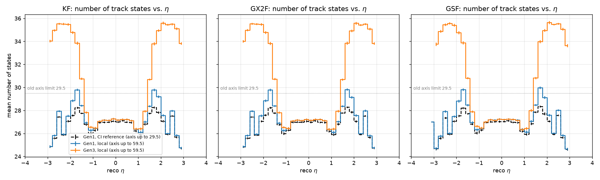
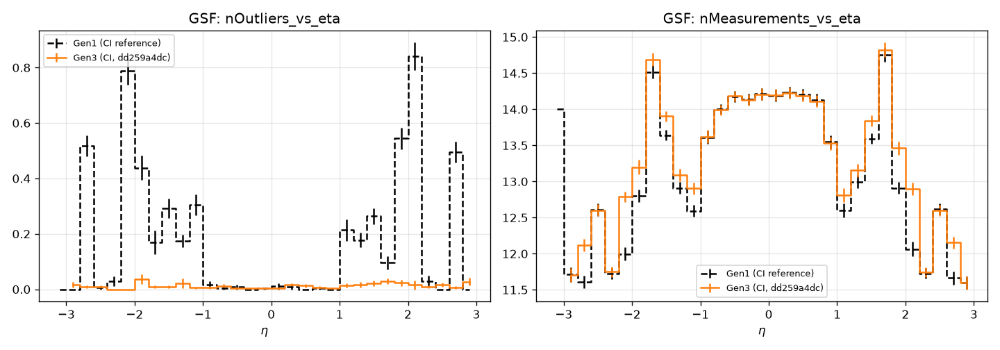

# Physmon simulation: Gen3 vs. Gen1 (Fatras and Geant4)

Local runs of `CI/physmon/workflows/physmon_simulation.py` (particle gun:
one muon, pion and electron per event, 1000 events, seed 42) on
`gen3-default` (`dd259a4dc`), 2026-11-06. Histograms were made with
`Examples/Scripts/generic_plotter.py` and `CI/physmon/config/simulation.yml`,
reports with `histcmp==0.12.0` and `CI/physmon/config/standard.toml`, the
same tools and settings as the physmon CI job.

`reference/` holds the Gen1 reference histograms used by the CI (sha256
`acf50e81…` for Fatras, `7ff5f21c…` for Geant4, fetched from the physmon
reference registry).

| Folder | Geometry | Material map | Geant4 kill volume | Fatras failed | Geant4 failed |
|---|---|---|---|---|---|
| `0_gen1_local` | Gen1 | official Gen1 ODD map | Gen1 `highestTrackingVolume` (r ≤ 1202 mm, \|z\| ≤ 4002 mm) | 0/20 | 0/20 |
| `1_gen3_as_in_ci` | Gen3 | provisional Gen3 map (release v1, with calorimeter collector) | Gen3 `highestTrackingVolume` (r ≤ 1245 mm, \|z\| ≤ 4020 mm) | 19/20 | 20/20 |
| `2_gen3_no_collector_material` | Gen3 | same map, collector bins set to vacuum | Gen3 | 12/20 | 20/20 |
| `3_gen3_no_collector_material_gen1_kill_volume` | Gen3 | same map, collector bins set to vacuum | Gen1 extent, set locally | 12/20 | **0/20** |

Each folder contains `particles_{gun,fatras,geant4}.root` (particle ntuples),
`particles_{fatras,geant4}_hist.root` (physmon histograms),
`report_{fatras,geant4}.html` (histcmp report against `reference/`, open in a
browser) and `simulation.log`.

## Findings

- **Local runs reproduce the CI.** `1_gen3_as_in_ci` gives exactly the particle
  counts of the Gen3 CI run (Fatras 11 646, Geant4 98 739).
- **Fatras: the calorimeter collector is the dominant cause.** The Gen3 map
  carries the calorimeter material on a thin collector surface outside the
  solenoid, which the Gen1 map does not have (Gen1 ends at the solenoid,
  ~0.45 X0). Without the collector material:
  - the particle count drops from 11 646 to 6 435 (Gen1: 6 172),
  - the `total_x0` overflow above 3 X0 drops from 4 119 to 0,
  - particles with more than 21 hits (electrons curling back into the
    tracker) disappear.

  What remains is +4.3 % secondaries and a slightly different `total_x0`
  shape (KS 0.005), i.e. the newly mapped tracker material. histcmp still
  fails, mainly on ResidualCheck and KolmogorovTest. The kill volume has no
  effect on Fatras (2 and 3 are identical).
- **Geant4: the larger kill volume is the only cause.** Geant4 does not use
  the ACTS material map (1 and 2 are identical). With a kill volume of the
  Gen1 extent, the Geant4 particles are bit-identical to `0_gen1_local` in all
  1000 events. The Gen3 `highestTrackingVolume` extends further out
  (r 1202 → 1245 mm), so Geant4 keeps tracking particles there and produces
  additional secondaries, including hadronic ones. This shifts the random
  number sequence and changes the rest of the event, which looks like
  "RNG wiggling" in the histograms. The remaining 6 particles difference to
  the CI reference (97 135 vs. 97 129) also appear in `0_gen1_local`, so they
  come from the local environment, not from Gen3.

## How the variants were produced

All variants start from `gen3-default` at `dd259a4dc`. The local changes
are stored as patches in `inputs/`:

| Variant | Patch | What it changes |
|---|---|---|
| 0 | `inputs/variant0_gen1.patch` | `physmon_common.py` builds `getOpenDataDetector(gen3=False)` with its default Gen1 map |
| 1 | none | unchanged code, downloads the provisional Gen3 map (release v1) |
| 2 | `inputs/variant2_local_changes.patch` | map URL in `physmon_common.py` points to the collector-free map |
| 3 | `inputs/variant3_local_changes.patch` | as 2, plus a kill volume with the Gen1 extent in `physmon_simulation.py`: `acts.TrackingVolume(acts.Transform3.Identity(), acts.CylinderVolumeBounds(0.0, 1202.0, 4002.0), "Gen1KillVolume")` |

The collector-free map keeps all 105 surface entries (every designated
material key must be present); only the 14 400 bins of each of the three
`CaloMaterialCollector*` surfaces are replaced by
`{"material": {"kind": "vacuum"}, "thickness": 0.0}` using
`inputs/vacuum_collector.jq`.

## How to reproduce

### 0. Environment

Standalone ACTS build with Python bindings and the DD4hep/Geant4 plugins
(here: `~/Documents/PhD/ACTS/acts/build`, environment via
`source ~/setup_acts.sh`). All commands below run from the ACTS source
directory, checked out at `dd259a4dc`, with a clean `CI/physmon/`
(`git status` shows no changes there).

### 1. Collector-free map (variants 2 and 3 only)

Download the provisional Gen3 map and set the collector bins to vacuum.
Compress from a file, not from a pipe: ACTS needs the content size in the
zstd header.

```bash
curl -L -o odd_gen3_map.json.zst \
  https://github.com/LeaBaumann/acts/releases/download/gen3-material-map-provisional-v1/odd_gen3_map.json.zst
zstd -dc odd_gen3_map.json.zst \
  | jq --indent 4 -f <this folder>/inputs/vacuum_collector.jq > odd_gen3_map_nocalo.json
zstd -19 odd_gen3_map_nocalo.json   # -> odd_gen3_map_nocalo.json.zst
```

The patches for variants 2 and 3 contain a `file://` URL with a local path.
Adapt it in `CI/physmon/physmon_common.py` after applying the patch.

### 2. Apply the patch of the variant

```bash
git apply <this folder>/inputs/variant3_local_changes.patch   # example: variant 3
git diff CI/physmon                                          # check
```

### 3. Run the simulation

```bash
source CI/physmon/setup.sh   # puts CI/physmon (physmon_common) and Examples/Scripts/Python on PYTHONPATH
python3 CI/physmon/workflows/physmon_simulation.py <outdir> 2>&1 | tee <outdir>/simulation.log
```

This simulates 1000 particle-gun events with Fatras and Geant4 and writes
`particles_{gun,fatras,geant4}.root` to `<outdir>`. The script then fails in
its second part (ttbar) if ACTS is built without Pythia8; this is harmless,
the particle-gun outputs are already written at that point.

### 4. Make the histograms

As in `CI/physmon/phys_perf_mon.sh` (function `simulation`). `generic_plotter.py`
needs `typer`, `uproot`, `hist`, ...; with `uv` they can be pulled in ad hoc:

```bash
for s in fatras geant4; do
  uv run --no-project --python 3.13 \
    --with uproot,typer,hist,pydantic,pyyaml,matplotlib,awkward \
    python Examples/Scripts/generic_plotter.py \
      <outdir>/particles_${s}.root particles <outdir>/particles_${s}_hist.root \
      --silent --config CI/physmon/config/simulation.yml
done
```

### 5. Compare with the reference

`histcmp` needs PyROOT, so it runs with the Python of the ACTS environment.
The Gen1 references are in `reference/` (in general: the hashes are listed
in `CI/physmon/reference.sha256` and the files live in
`ghcr.io/acts-project/physmon-references`).

```bash
for s in fatras geant4; do
  uv run --no-project --python $(which python3) --with histcmp==0.12.0 \
    histcmp <outdir>/particles_${s}_hist.root <this folder>/reference/particles_${s}_hist.root \
      --config CI/physmon/config/standard.toml \
      --label-reference "Gen1 (CI reference)" --label-monitored "<variant label>" \
      --title "${s} particles: <variant label> vs. Gen1 (CI reference)" \
      -o <outdir>/report_${s}.html > <outdir>/histcmp_${s}.log 2>&1
done
```

A non-zero exit code of `histcmp` means at least one comparison failed; the
summary is at the end of `histcmp_*.log`, the plots in `report_*.html`.

### 6. Restore the code

```bash
git checkout CI/physmon/physmon_common.py CI/physmon/workflows/physmon_simulation.py
```

### Saving local changes as a patch

To record new local changes in the same way:

```bash
git diff -- CI/physmon > <this folder>/inputs/<name>.patch   # write the patch
git apply --check <this folder>/inputs/<name>.patch           # later: test if it applies
git apply <this folder>/inputs/<name>.patch                   # later: apply it
```

`git diff` only records the changes relative to the current commit, so note
the base commit (here `dd259a4dc`) next to the patch.

---

# Track fitting: number of track states (`nStates`)

Folder `nstates/`. Question: why do the `nStates_vs_eta` profiles of the
track-fitting workflows (KF, GX2F, GSF, also refits and CKF) look cut off in
Gen3?



## Findings

- **The cut-off is a plotting artifact.** The profiles use the y-axis
  `BoostRegularAxis(30, -0.5, 29.5)`
  (`Examples/Framework/include/ActsExamples/Validation/TrackSummaryPlotTool.hpp`),
  and `ProfileHistogram` discards samples outside this range
  (`Core/include/Acts/Utilities/Histogram.hpp`, `sampleRange`). Tracks with
  30 or more states are therefore missing from the profile.
- **Gen1 was already affected.** The Gen1 CI reference of the KF contains only
  8 798 of 10 000 tracks; at 1.6 < |η| < 1.8 only 153 of 318 tracks are left
  (mean 28.3 instead of 29.8 with all tracks).
- **With the axis widened to 59.5, the cut-off disappears** (all 10 000 tracks
  in the profile, KF, GX2F and GSF alike). Gen3 then shows about 34–35.6 states
  for |η| > 1.6, compared to 25–30 in Gen1. In the barrel (|η| < 1), Gen1 and
  Gen3 are identical (27.16 vs. 27.16).
- **Origin of the extra states: two material surfaces per endcap layer.**
  Measurements, outliers and holes per track are identical in Gen1 and Gen3;
  the difference consists only of material-only states in the forward region
  (KF, 2.0 < |η| < 2.5: 14.8 → 23.2 material states per track). Gen1 has one
  material state per endcap layer at the layer centre (e.g. |z| = 1550 mm),
  Gen3 two at about ±10 mm (1540 and 1560 mm). The Gen3 ODD builder puts
  material on both disc faces of each endcap layer
  (`Plugins/DD4hep/src/OpenDataDetectorBuilder.cpp`, `customizeLayer`), but
  on only one cylinder face per barrel layer.
- **No effect on the fit quality.** The material is split between the two
  faces, not doubled. Pulls, resolution and χ²/ndf agree between Gen1 and
  Gen3 within statistics (KF, 1.5 < |η| < 3: pull q/p 0.939 vs. 0.949,
  χ²/ndf 0.784 vs. 0.786). The cost is about 8 more states per forward track.
- **Options:** (a) widen the `Num` axis (fixes a bias that already exists in
  Gen1, changes all references with this profile); (b) one material surface
  per endcap layer (Gen1-like state count, needs a new mapping).

## Contents of `nstates/`

| Path | Content |
|---|---|
| `nStates_vs_eta_axis59p5.png` | profiles KF/GX2F/GSF: Gen1 CI reference (axis up to 29.5), local Gen1 and Gen3 (axis up to 59.5) |
| `results/profiles_nStates_vs_eta.txt` | the same as a table, with the number of entries per bin |
| `results/state_types_kf_1000ev.txt` | state types per track by \|η\|, position of the material states along \|z\|, fit quality |
| `results/widths_gen3_vs_gen1.txt` | widths of residual and pull distributions, Gen3 vs. Gen1 |
| `data/axis59p5/{gen1,gen3}/trackfitting_{kf,gx2f,gsf}/` | `performance_trackfitting.root` of the physmon workflows, 10 000 events, axis up to 59.5 |
| `data/kf_1000ev/{gen1,gen3}/` | KF with track states written (`trackstates_kf.root`, `tracksummary_kf.root`), 1000 events, original axis |
| `reference/` | Gen1 CI references `trackfitting_{kf,gx2f,gsf}/performance_trackfitting.root` |
| `scripts/` | analysis scripts (`state_types.py`, `profiles.py`, `widths.py`) and `run_kf_with_states.py` |
| `inputs/axis_59p5.patch` | local change of the `Num` axis |

## How to reproduce

Same environment and base commit (`dd259a4dc`) as above.

1. Axis: `git apply nstates/inputs/axis_59p5.patch`, then rebuild ACTS
   (`cmake --build build`).
2. Gen1 runs: apply `inputs/variant0_gen1.patch` and restore the Gen1 digi
   config, which `64a107fa3` regenerated for Gen3 volume IDs:
   ```bash
   git show 64a107fa3^:Examples/Configs/odd-digi-smearing-config.json > Examples/Configs/odd-digi-smearing-config.json
   ```
   Gen3 runs: unchanged code (provisional Gen3 map, release v1).
3. Run the workflows as in `CI/physmon/phys_perf_mon.sh`; the GSF fit needs the
   output of `simulation_gsf` next to it:
   ```bash
   source CI/physmon/setup.sh
   for slug in trackfitting_kf trackfitting_gx2f simulation_gsf trackfitting_gsf; do
     python3 CI/physmon/workflows/physmon_${slug}.py <outdir>/${slug}
   done
   ```
4. Track states (1000 events, without the axis patch):
   `DIGI=$PWD/Examples/Configs/odd-digi-smearing-config.json python3 <this folder>/nstates/scripts/run_kf_with_states.py <outdir>`
   after `source CI/physmon/setup.sh`, with the same Gen1/Gen3 setup as in
   step 2 (copies the output files to `<outdir>`).
5. Analysis (needs `uproot`, `numpy`, `awkward`, `matplotlib`), run from the root of this repository:
   ```bash
   python3 nstates/scripts/state_types.py > nstates/results/state_types_kf_1000ev.txt
   python3 nstates/scripts/profiles.py    > nstates/results/profiles_nStates_vs_eta.txt   # also writes the plot
   python3 nstates/scripts/widths.py      > nstates/results/widths_gen3_vs_gen1.txt
   ```
6. Restore the code: `git checkout Examples/` and rebuild.

---

# Review points from the PR #6273 discussion

Folder `review_points/`. Checks of the points raised in the review of
PR #6273 (physmon run of `gen3-default` @ `dd259a4dc`; reports:
`https://acts-herald.app.cern.ch/view/acts-project/acts/13004175552/html/`).
"CI Gen3" below means the physmon output of that run, compared to the Gen1
CI references.

| Review point | Explained by the nStates cut-off? | Cause |
|---|---|---|
| KF, GX2F, KF refit: nStates cut-off | yes | see `nstates/` |
| KF, GX2F, KF refit: "distributions get wider" | no | plotting artifact (1) |
| GSF fit and refit: number of outliers | no | Gen1 navigation gap, fixed in Gen3 (2) |
| GSF, CKF (1muon, ttbar): nStates | yes | see `nstates/` |
| ttbar: track errors change, pulls do not | no | different material description (3) |
| ttbar: purity reduced at the acceptance edge | no | real effect at \|η\| > 3, cause open (4) |
| 1muon CKF: `measurementLayer/Volume`, `outlierLayer/Volume` | no | geometry IDs are numbered differently in Gen3; these cannot agree |

## 1. "Other distributions seem to go wider" (KF, GX2F, KF refit)


Apart from nStates, only `reswidth_*` / `resmean_*` comparisons fail
(`results/ci_failed_comparisons.txt`). These histograms hold the width of a
Gaussian fit per bin; if the fit fails, the bin stays at 0, which is the case
for most bins. The comparison fails when a bin switches between "fit
succeeded" and "fit failed" (KF `reswidth_qopt_vs_eta`: 7 such bins). Where
both have a value, Gen1 and Gen3 agree within a few percent (0.95–1.07). The
pulls stay at about 1. No real widening; the fragility of these plots is
independent of Gen3.

## 2. GSF outliers: a Gen1 navigation gap at the barrel ends




- **What an outlier is here.** physmon's GSF has no χ²-based outlier finder.
  A measurement becomes an outlier only if the backward pass does not reach
  its surface (`Core/include/Acts/TrackFitting/GaussianSumFitter.hpp`, "Assign
  outliers to states whose surface the backward pass did not reach").
- **Numbers.** Gen1 0.181 outliers per track, all at \|η\| > 1; Gen3 0.012
  (CI and local runs agree exactly). In the same events
  (`results/gsf_same_events.txt`), 1 772 Gen1 outliers become 1 752 regular
  measurements in Gen3; measurements + outliers per track are identical in
  99.7 % of the tracks.
- **Where.** 93.7 % of the Gen1 outliers sit on the last module ring of a
  barrel layer (pixel barrel modules end at \|z\| = 507 mm, strip barrels at
  1139–1141 mm). For 78.5 % this is the last hit of the track in that barrel;
  the next hit further out is in an endcap (`results/gen1_gsf_outliers.txt`).
- **Why.** Gen1 finds a barrel layer via an inner and an outer approach
  cylinder, which end only 5–10 mm beyond the modules
  (`results/gen1_barrel_approach_geometry.txt`). In the forward pass, the
  track reaches the layer through the inner approach cylinder at smaller
  \|z\|. In the backward pass, the track comes back from the endcap and would
  have to cross the outer approach cylinder; being inclined, it crosses that
  radius at larger \|z\|, beyond the end of the cylinder. The navigator skips
  the layer, and the measurement becomes an outlier. This applies to 93.5 % of
  the Gen1 outliers but only 0.2 % of the regular measurements (right-hand
  plot above).
- **Gen3.** Each layer is a volume with portals on all sides, and the
  modules come from the surface array of the layer volume, without approach
  cylinders. The backward pass finds these modules, so the GSF now uses them.
  The other GSF changes (pull means, residuals) follow from the extra
  measurements; the pull widths stay comparable.

## 3. ttbar: track errors change, pulls do not


`err_eTHETA_fit` +8 %, `err_eLOC0_fit` +4.5 %, while the pull widths agree
(θ: 1.094 vs. 1.084, d0: 1.197 vs. 1.187; `results/ci_comparison.txt`).
Fatras simulates with the Gen3 map and the fit uses the same map, so a
different material description changes the errors consistently in simulation
and reconstruction. Whether the Gen3 map is closer to Geant4 than the Gen1 map
is a question for the material validation, not for physmon.

## 4. ttbar purity at the acceptance edge (open)


Purity = fraction of the measurements on a track that belong to the matched
particle. Up to \|η\| = 3, Gen1 and Gen3 agree (0.996–0.999 with the ML
solver). Beyond, combining both sides:

| \|η\| > 3 | tracks Gen1 / Gen3 | outliers Gen1 / Gen3 | purity Gen1 / Gen3 |
|---|---|---|---|
| CKF + ML solver | 64 / 57 | 6 / 18 | 0.988 / 0.965 |
| CKF | 119 / 104 | 18 / 31 | 0.962 / 0.937 |

Gen3 has fewer tracks, more outliers and a lower purity at the edge on both
sides. This is a real effect, not a fluctuation. The cause is not identified
yet. One candidate: the CI ttbar simulation still uses the map with the
calorimeter collector, whose discs (\|z\| = 3175 mm) sit right behind the last
endcap discs, so secondaries from there can add hits at small radius, i.e.
large \|η\|. A navigation effect at the inner edge of the Gen3 endcaps is the
other candidate. Separating the two needs a forward sample (e.g. muons at
\|η\| 2.8–3.5) with and without the collector material; ttbar itself cannot be
produced locally here (no Pythia8).

Side note: in the CKF without the ML solver, Gen1 has a purity dip at
\|η\| ≈ 1.3 (0.876, with 638 tracks instead of about 370 in the neighbouring
bins, i.e. many split tracks). It is gone in Gen3 (0.953, 457 tracks): the
barrel-endcap transition, the same region as in point 2.

## Contents of `review_points/`

| Path | Content |
|---|---|
| `plots/` | the plots shown above |
| `results/ci_failed_comparisons.txt` | failed histcmp comparisons per CI report |
| `results/ci_comparison.txt` | tables behind points 1, 2a, 3, 4 |
| `results/gen1_gsf_outliers.txt`, `results/gsf_same_events.txt` | point 2 summary |
| `results/gen1_gsf_barrel_states.csv` | all measurement/outlier states on Gen1 barrel layers (GSF, local run) with the approach-cylinder crossing |
| `results/gen1_barrel_approach_geometry.txt` | Gen1 barrel layers: approach cylinders and module extent |
| `data/ci_gen3/`, `reference/` | CI Gen3 output and Gen1 CI references of the relevant workflows |
| `data/gsf_local/{gen1,gen3}/` | local GSF runs (same Geant4 events as physmon): track summaries and performance files |
| `scripts/` | `ci_failed.py` (needs internet), `compare_ci.py`, `run_gsf_with_states.py`, `gsf_outliers.py`, `gsf_plots.py`, `gen1_approach.py` (needs the ACTS Python environment) |

## How to reproduce

- `compare_ci.py`, `gsf_plots.py`: run from the root of this repository with
  `uproot`, `numpy`, `awkward`, `matplotlib`; they read only files in this folder.
- Local GSF runs: as for the track fitting in `nstates/` (Gen1: `inputs/variant0_gen1.patch`
  plus the Gen1 digi config), first `CI/physmon/workflows/physmon_simulation_gsf.py <dir>/simulation_gsf`,
  then `python3 <this folder>/review_points/scripts/run_gsf_with_states.py <dir>/gsf_full`
  (a copy of `physmon_trackfitting_gsf.py` that also keeps `trackstates_gsf.root` and
  `tracksummary_gsf.root`).
- `gsf_outliers.py <dir>/gsf_full/trackstates_gsf.root` (Gen1 run) writes the CSV;
  the track-states file (138 MB) is not stored here.
