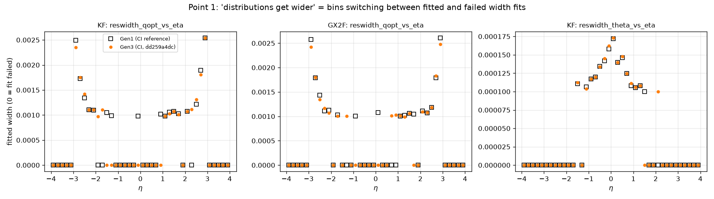
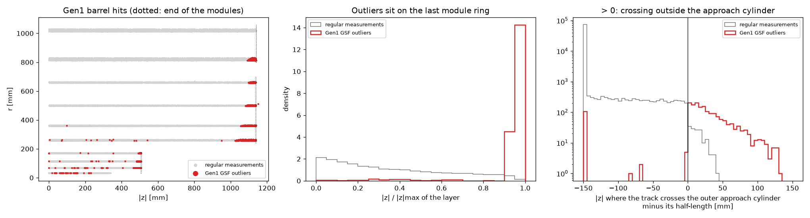
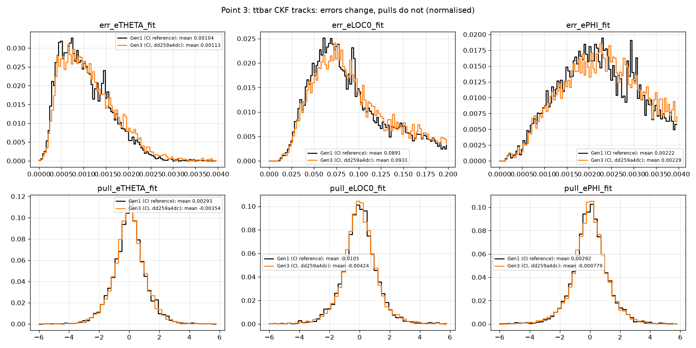
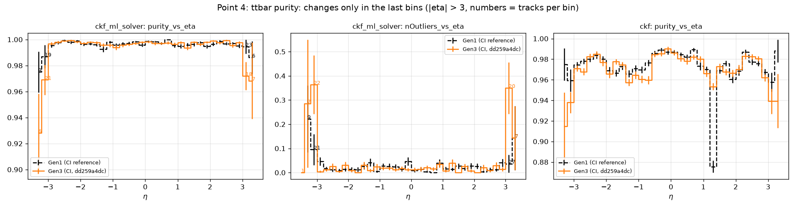

# Physmon simulation: Gen3 vs. Gen1 (Fatras and Geant4)

Local runs of `CI/physmon/workflows/physmon_simulation.py` (particle gun:
one muon, pion and electron per event, 1000 events, seed 42) on
`gen3-default` (`dd259a4dc`), 2026-11-06. Histograms were made with
`Examples/Scripts/generic_plotter.py` and `CI/physmon/config/simulation.yml`,
reports with `histcmp==0.12.0` and `CI/physmon/config/standard.toml`, the
same tools and settings as the physmon CI job.

`reference/` holds the Gen1 reference histograms used by the CI (sha256
`acf50e81…` for Fatras, `7ff5f21c…` for Geant4, fetched from the physmon
reference registry).

| Folder | Geometry | Material map | Geant4 kill volume | Fatras failed | Geant4 failed |
|---|---|---|---|---|---|
| `0_gen1_local` | Gen1 | official Gen1 ODD map | Gen1 `highestTrackingVolume` (r ≤ 1202 mm, \|z\| ≤ 4002 mm) | 0/20 | 0/20 |
| `1_gen3_as_in_ci` | Gen3 | provisional Gen3 map (release v1, with calorimeter collector) | Gen3 `highestTrackingVolume` (r ≤ 1245 mm, \|z\| ≤ 4020 mm) | 19/20 | 20/20 |
| `2_gen3_no_collector_material` | Gen3 | same map, collector bins set to vacuum | Gen3 | 12/20 | 20/20 |
| `3_gen3_no_collector_material_gen1_kill_volume` | Gen3 | same map, collector bins set to vacuum | Gen1 extent, set locally | 12/20 | **0/20** |

Each folder contains `particles_{gun,fatras,geant4}.root` (particle ntuples),
`particles_{fatras,geant4}_hist.root` (physmon histograms),
`report_{fatras,geant4}.html` (histcmp report against `reference/`, open in a
browser) and `simulation.log`.

## Findings

- **Local runs reproduce the CI.** `1_gen3_as_in_ci` gives exactly the particle
  counts of the Gen3 CI run (Fatras 11 646, Geant4 98 739).
- **Fatras: the calorimeter collector is the dominant cause.** The Gen3 map
  carries the calorimeter material on a thin collector surface outside the
  solenoid, which the Gen1 map does not have (Gen1 ends at the solenoid,
  ~0.45 X0). Without the collector material:
  - the particle count drops from 11 646 to 6 435 (Gen1: 6 172),
  - the `total_x0` overflow above 3 X0 drops from 4 119 to 0,
  - particles with more than 21 hits (electrons curling back into the
    tracker) disappear.

  What remains is +4.3 % secondaries and a slightly different `total_x0`
  shape (KS 0.005), i.e. the newly mapped tracker material. histcmp still
  fails, mainly on ResidualCheck and KolmogorovTest. The kill volume has no
  effect on Fatras (2 and 3 are identical).
- **Geant4: the larger kill volume is the only cause.** Geant4 does not use
  the ACTS material map (1 and 2 are identical). With a kill volume of the
  Gen1 extent, the Geant4 particles are bit-identical to `0_gen1_local` in all
  1000 events. The Gen3 `highestTrackingVolume` extends further out
  (r 1202 → 1245 mm), so Geant4 keeps tracking particles there and produces
  additional secondaries, including hadronic ones. This shifts the random
  number sequence and changes the rest of the event, which looks like
  "RNG wiggling" in the histograms. The remaining 6 particles difference to
  the CI reference (97 135 vs. 97 129) also appear in `0_gen1_local`, so they
  come from the local environment, not from Gen3.

## How the variants were produced

All variants start from `gen3-default` at `dd259a4dc`. The local changes
are stored as patches in `inputs/`:

| Variant | Patch | What it changes |
|---|---|---|
| 0 | `inputs/variant0_gen1.patch` | `physmon_common.py` builds `getOpenDataDetector(gen3=False)` with its default Gen1 map |
| 1 | none | unchanged code, downloads the provisional Gen3 map (release v1) |
| 2 | `inputs/variant2_local_changes.patch` | map URL in `physmon_common.py` points to the collector-free map |
| 3 | `inputs/variant3_local_changes.patch` | as 2, plus a kill volume with the Gen1 extent in `physmon_simulation.py`: `acts.TrackingVolume(acts.Transform3.Identity(), acts.CylinderVolumeBounds(0.0, 1202.0, 4002.0), "Gen1KillVolume")` |

The collector-free map keeps all 105 surface entries (every designated
material key must be present); only the 14 400 bins of each of the three
`CaloMaterialCollector*` surfaces are replaced by
`{"material": {"kind": "vacuum"}, "thickness": 0.0}` using
`inputs/vacuum_collector.jq`.

## How to reproduce

### 0. Environment

Standalone ACTS build with Python bindings and the DD4hep/Geant4 plugins
(here: `~/Documents/PhD/ACTS/acts/build`, environment via
`source ~/setup_acts.sh`). All commands below run from the ACTS source
directory, checked out at `dd259a4dc`, with a clean `CI/physmon/`
(`git status` shows no changes there).

### 1. Collector-free map (variants 2 and 3 only)

Download the provisional Gen3 map and set the collector bins to vacuum.
Compress from a file, not from a pipe: ACTS needs the content size in the
zstd header.

```bash
curl -L -o odd_gen3_map.json.zst \
  https://github.com/LeaBaumann/acts/releases/download/gen3-material-map-provisional-v1/odd_gen3_map.json.zst
zstd -dc odd_gen3_map.json.zst \
  | jq --indent 4 -f <this folder>/inputs/vacuum_collector.jq > odd_gen3_map_nocalo.json
zstd -19 odd_gen3_map_nocalo.json   # -> odd_gen3_map_nocalo.json.zst
```

The patches for variants 2 and 3 contain a `file://` URL with a local path.
Adapt it in `CI/physmon/physmon_common.py` after applying the patch.

### 2. Apply the patch of the variant

```bash
git apply <this folder>/inputs/variant3_local_changes.patch   # example: variant 3
git diff CI/physmon                                          # check
```

### 3. Run the simulation

```bash
source CI/physmon/setup.sh   # puts CI/physmon (physmon_common) and Examples/Scripts/Python on PYTHONPATH
python3 CI/physmon/workflows/physmon_simulation.py <outdir> 2>&1 | tee <outdir>/simulation.log
```

This simulates 1000 particle-gun events with Fatras and Geant4 and writes
`particles_{gun,fatras,geant4}.root` to `<outdir>`. The script then fails in
its second part (ttbar) if ACTS is built without Pythia8; this is harmless,
the particle-gun outputs are already written at that point.

### 4. Make the histograms

As in `CI/physmon/phys_perf_mon.sh` (function `simulation`). `generic_plotter.py`
needs `typer`, `uproot`, `hist`, ...; with `uv` they can be pulled in ad hoc:

```bash
for s in fatras geant4; do
  uv run --no-project --python 3.13 \
    --with uproot,typer,hist,pydantic,pyyaml,matplotlib,awkward \
    python Examples/Scripts/generic_plotter.py \
      <outdir>/particles_${s}.root particles <outdir>/particles_${s}_hist.root \
      --silent --config CI/physmon/config/simulation.yml
done
```

### 5. Compare with the reference

`histcmp` needs PyROOT, so it runs with the Python of the ACTS environment.
The Gen1 references are in `reference/` (in general: the hashes are listed
in `CI/physmon/reference.sha256` and the files live in
`ghcr.io/acts-project/physmon-references`).

```bash
for s in fatras geant4; do
  uv run --no-project --python $(which python3) --with histcmp==0.12.0 \
    histcmp <outdir>/particles_${s}_hist.root <this folder>/reference/particles_${s}_hist.root \
      --config CI/physmon/config/standard.toml \
      --label-reference "Gen1 (CI reference)" --label-monitored "<variant label>" \
      --title "${s} particles: <variant label> vs. Gen1 (CI reference)" \
      -o <outdir>/report_${s}.html > <outdir>/histcmp_${s}.log 2>&1
done
```

A non-zero exit code of `histcmp` means at least one comparison failed; the
summary is at the end of `histcmp_*.log`, the plots in `report_*.html`.

### 6. Restore the code

```bash
git checkout CI/physmon/physmon_common.py CI/physmon/workflows/physmon_simulation.py
```

### Saving local changes as a patch

To record new local changes in the same way:

```bash
git diff -- CI/physmon > <this folder>/inputs/<name>.patch   # write the patch
git apply --check <this folder>/inputs/<name>.patch           # later: test if it applies
git apply <this folder>/inputs/<name>.patch                   # later: apply it
```

`git diff` only records the changes relative to the current commit, so note
the base commit (here `dd259a4dc`) next to the patch.

---

# Track fitting: number of track states (`nStates`)

Folder `nstates/`. Question: why do the `nStates_vs_eta` profiles of the
track-fitting workflows (KF, GX2F, GSF, also refits and CKF) look cut off in
Gen3?


## Findings

- **The cut-off is a plotting artifact.** The profiles use the y-axis
  `BoostRegularAxis(30, -0.5, 29.5)`
  (`Examples/Framework/include/ActsExamples/Validation/TrackSummaryPlotTool.hpp`),
  and `ProfileHistogram` discards samples outside this range
  (`Core/include/Acts/Utilities/Histogram.hpp`, `sampleRange`). Tracks with
  30 or more states are therefore missing from the profile.
- **Gen1 was already affected.** The Gen1 CI reference of the KF contains only
  8 798 of 10 000 tracks; at 1.6 < |η| < 1.8 only 153 of 318 tracks are left
  (mean 28.3 instead of 29.8 with all tracks).
- **With the axis widened to 59.5, the cut-off disappears** (all 10 000 tracks
  in the profile, KF, GX2F and GSF alike). Gen3 then shows about 34–35.6 states
  for |η| > 1.6, compared to 25–30 in Gen1. In the barrel (|η| < 1), Gen1 and
  Gen3 are identical (27.16 vs. 27.16).
- **Origin of the extra states: two material surfaces per endcap layer.**
  Measurements, outliers and holes per track are identical in Gen1 and Gen3;
  the difference consists only of material-only states in the forward region
  (KF, 2.0 < |η| < 2.5: 14.8 → 23.2 material states per track). Gen1 has one
  material state per endcap layer at the layer centre (e.g. |z| = 1550 mm),
  Gen3 two at about ±10 mm (1540 and 1560 mm). The Gen3 ODD builder puts
  material on both disc faces of each endcap layer
  (`Plugins/DD4hep/src/OpenDataDetectorBuilder.cpp`, `customizeLayer`), but
  on only one cylinder face per barrel layer.
- **No effect on the fit quality.** The material is split between the two
  faces, not doubled. Pulls, resolution and χ²/ndf agree between Gen1 and
  Gen3 within statistics (KF, 1.5 < |η| < 3: pull q/p 0.939 vs. 0.949,
  χ²/ndf 0.784 vs. 0.786). The cost is about 8 more states per forward track.
- **Options:** (a) widen the `Num` axis (fixes a bias that already exists in
  Gen1, changes all references with this profile); (b) one material surface
  per endcap layer (Gen1-like state count, needs a new mapping).

## Contents of `nstates/`

| Path | Content |
|---|---|
| `nStates_vs_eta_axis59p5.png` | profiles KF/GX2F/GSF: Gen1 CI reference (axis up to 29.5), local Gen1 and Gen3 (axis up to 59.5) |
| `results/profiles_nStates_vs_eta.txt` | the same as a table, with the number of entries per bin |
| `results/state_types_kf_1000ev.txt` | state types per track by \|η\|, position of the material states along \|z\|, fit quality |
| `results/widths_gen3_vs_gen1.txt` | widths of residual and pull distributions, Gen3 vs. Gen1 |
| `data/axis59p5/{gen1,gen3}/trackfitting_{kf,gx2f,gsf}/` | `performance_trackfitting.root` of the physmon workflows, 10 000 events, axis up to 59.5 |
| `data/kf_1000ev/{gen1,gen3}/` | KF with track states written (`trackstates_kf.root`, `tracksummary_kf.root`), 1000 events, original axis |
| `reference/` | Gen1 CI references `trackfitting_{kf,gx2f,gsf}/performance_trackfitting.root` |
| `scripts/` | analysis scripts (`state_types.py`, `profiles.py`, `widths.py`) and `run_kf_with_states.py` |
| `inputs/axis_59p5.patch` | local change of the `Num` axis |

## How to reproduce

Same environment and base commit (`dd259a4dc`) as above.

1. Axis: `git apply nstates/inputs/axis_59p5.patch`, then rebuild ACTS
   (`cmake --build build`).
2. Gen1 runs: apply `inputs/variant0_gen1.patch` and restore the Gen1 digi
   config, which `64a107fa3` regenerated for Gen3 volume IDs:
   ```bash
   git show 64a107fa3^:Examples/Configs/odd-digi-smearing-config.json > Examples/Configs/odd-digi-smearing-config.json
   ```
   Gen3 runs: unchanged code (provisional Gen3 map, release v1).
3. Run the workflows as in `CI/physmon/phys_perf_mon.sh`; the GSF fit needs the
   output of `simulation_gsf` next to it:
   ```bash
   source CI/physmon/setup.sh
   for slug in trackfitting_kf trackfitting_gx2f simulation_gsf trackfitting_gsf; do
     python3 CI/physmon/workflows/physmon_${slug}.py <outdir>/${slug}
   done
   ```
4. Track states (1000 events, without the axis patch):
   `DIGI=$PWD/Examples/Configs/odd-digi-smearing-config.json python3 <this folder>/nstates/scripts/run_kf_with_states.py <outdir>`
   after `source CI/physmon/setup.sh`, with the same Gen1/Gen3 setup as in
   step 2 (copies the output files to `<outdir>`).
5. Analysis (needs `uproot`, `numpy`, `awkward`, `matplotlib`), run from the root of this repository:
   ```bash
   python3 nstates/scripts/state_types.py > nstates/results/state_types_kf_1000ev.txt
   python3 nstates/scripts/profiles.py    > nstates/results/profiles_nStates_vs_eta.txt   # also writes the plot
   python3 nstates/scripts/widths.py      > nstates/results/widths_gen3_vs_gen1.txt
   ```
6. Restore the code: `git checkout Examples/` and rebuild.

---

# Review points from the PR #6273 discussion

Folder `review_points/`. Checks of the points raised in the review of
PR #6273 (physmon run of `gen3-default` @ `dd259a4dc`; reports:
`https://acts-herald.app.cern.ch/view/acts-project/acts/13004175552/html/`).
"CI Gen3" below means the physmon output of that run, compared to the Gen1
CI references.

| Review point | Explained by the nStates cut-off? | Cause |
|---|---|---|
| KF, GX2F, KF refit: nStates cut-off | yes | see `nstates/` |
| KF, GX2F, KF refit: "distributions get wider" | yes | few tracks left in the nStates profiles (1) |
| GSF fit and refit: number of outliers | no | Gen1 navigation gap, fixed in Gen3 (2) |
| GSF, CKF (1muon, ttbar): nStates | yes | see `nstates/` |
| ttbar: track errors change, pulls do not | no | multiple scattering with the Gen3 material map (3) |
| ttbar: purity reduced at the acceptance edge | no | ~55 tracks; duplicates, collector not involved (4) |
| 1muon CKF: remaining failures (not raised by Paul) | partly | IDs, errors as in (3), strict ResidualCheck (5) |

Points 1, 3, 4 and 5 were revisited on 2026-11-23; scripts, patches and
result tables of that follow-up are in `review_points/followup_2026-11-23/`
(listed at the end of this section).

## 1. "Other distributions seem to go wider" (KF, GX2F, KF refit)

Paul's remark follows directly on the nStates cut-off and refers to the
nStates profiles, e.g. ttbar ML solver `nStates_vs_eta`
(`trackfinding_ttbar_pu200/performance_finding_ckf_ml_solver.html#plot-24`;
per-bin table: `followup_2026-11-23/results/ttbar_ml_nStates_vs_eta.txt`).
Same cause as the cut-off: tracks with ≥ 30 states drop out of the profile,
and forward Gen3 tracks carry about 8 more material states. Forward, only
1–14 instead of about 220 Gen3 tracks per bin remain, so the error bars
(≈ σ/√N) become about 20 times larger and the points scatter. At
\|η\| ≈ 2.3–2.9 the Gen3 profile is empty (tracks have ~33 states). At the very
edge (\|η\| ≈ 3.1–3.3) tracks are short (7–9 measurements), stay just below 30
states in Gen3 (~28) and reappear above the Gen1 curve (~20). The single Gen3
bin at η ≈ −3.5 is one track. `nMeasurements_vs_eta` (`#plot-16`), which
counts no material states, agrees bin by bin; with the axis at 59.5 the
pattern disappears (`nstates/`).

Independently, `reswidth_*` / `resmean_*` comparisons also fail
(`results/ci_failed_comparisons.txt`): these hold a Gaussian fit per bin,
which fails (bin = 0) in many bins, and histcmp fails when a bin switches
between "fit succeeded" and "fit failed". Where both have a value, Gen1 and
Gen3 agree within 0.95–1.07. Paul did not refer to these.



## 2. GSF outliers: a Gen1 navigation gap at the barrel ends




- **What an outlier is here.** physmon's GSF has no χ²-based outlier finder.
  A measurement becomes an outlier only if the backward pass does not reach
  its surface (`Core/include/Acts/TrackFitting/GaussianSumFitter.hpp`, "Assign
  outliers to states whose surface the backward pass did not reach").
- **Numbers.** Gen1 0.181 outliers per track, all at \|η\| > 1; Gen3 0.012
  (CI and local runs agree exactly). In the same events
  (`results/gsf_same_events.txt`), 1 772 Gen1 outliers become 1 752 regular
  measurements in Gen3; measurements + outliers per track are identical in
  99.7 % of the tracks.
- **Where.** 93.7 % of the Gen1 outliers sit on the last module ring of a
  barrel layer (pixel barrel modules end at \|z\| = 507 mm, strip barrels at
  1139–1141 mm). For 78.5 % this is the last hit of the track in that barrel;
  the next hit further out is in an endcap (`results/gen1_gsf_outliers.txt`).
- **Why.** Gen1 finds a barrel layer via an inner and an outer approach
  cylinder, which end only 5–10 mm beyond the modules
  (`results/gen1_barrel_approach_geometry.txt`). In the forward pass, the
  track reaches the layer through the inner approach cylinder at smaller
  \|z\|. In the backward pass, the track comes back from the endcap and would
  have to cross the outer approach cylinder; being inclined, it crosses that
  radius at larger \|z\|, beyond the end of the cylinder. The navigator skips
  the layer, and the measurement becomes an outlier. This applies to 93.5 % of
  the Gen1 outliers but only 0.2 % of the regular measurements (right-hand
  plot above).
- **Gen3.** Each layer is a volume with portals on all sides, and the
  modules come from the surface array of the layer volume, without approach
  cylinders. The backward pass finds these modules, so the GSF now uses them.
  The other GSF changes (pull means, residuals) follow from the extra
  measurements; the pull widths stay comparable.

## 3. ttbar: track errors change, pulls do not



Plots `err_*` (`tracksummary_ckf.html#plot-8` to `#plot-12`) and `pull_*`
(`#plot-26` to `#plot-31`). The median errors on d0, z0, φ, θ grow by 8–12 %
(mean: θ +8 %, d0 +4.5 %), q/p is unchanged, pull widths agree within 1–2 %
(`results/ci_comparison.txt`, `followup_2026-11-23/results/ttbar_error_quantiles.txt`).
The whole distribution moves to larger errors: Gen3 lies below Gen1 at small
errors and above it at large ones, and more tracks fall into the overflow.
With ~10 000 tracks the means are known to ~0.5 %, so this is not a
fluctuation.

Checked with a local 1muon CKF run (`truth_smeared`, Gen1 and Gen3, same seed;
`followup_2026-11-23/results/1muon_local_tracks_gen1_vs_gen3.txt`):

- **Same tracks, same hits.** The muons are identical, and 95.7 % of the
  tracks have the same number of measurements on the same layers. For these
  tracks the errors still grow (median: d0 +1.7 %, z0 +3.6 %, φ +3.5 %,
  θ +5.0 %, q/p −0.3 %). The local run reproduces the CI numbers.
- **The growth scales with 1/pT**, as expected from multiple scattering:
  σ(θ) +7 % at pT 0.9–2 GeV, +3.7 % at 7–11 GeV; also larger forward
  (+2.7 % at \|η\| < 0.5, +7 % at \|η\| 2–3). The KF workflow (pT up to
  100 GeV, median 51 GeV) shows the same trend when split in pT (σ(θ) +8 % at
  1–4 GeV, +0.5 % at 30–100 GeV; `kf_errors_vs_pt.txt`), which is why its
  errors look unchanged overall.
- **The maps differ** (material validation with straight tracks through both
  geometries; `material_regions.txt`, `material_radial.txt`). Beam pipe and
  pixel layers are the same. In the barrel, Gen3 has ~12 % more material in
  the tracker, mostly on the long-strip layers (0.063 → 0.087 X0 at
  \|η\| < 0.5), and places it differently: at r = 204 mm (between pixels and
  strips) 0.0145 instead of 0.0072 X0, on the first short-strip layer 0.0099
  instead of 0.0172 X0. Forward, the total agrees within a few percent, but
  each disc carries material on both faces.

Fatras simulates with the same map, so the tracks really scatter more
(residuals in 1muon 3–6 % wider) and the pulls stay at 1. Which of the map
differences causes how much of the increase was not separated. Whether the
Gen3 map is closer to Geant4 than the Gen1 map is a question for the material
validation, not for physmon. ttbar itself could not be checked track by track
(no Pythia8 locally).

## 4. ttbar purity at the acceptance edge



Purity = fraction of the measurements on a track that belong to the matched
particle. Up to \|η\| = 3, Gen1 and Gen3 agree (0.996–0.999 with the ML
solver). Beyond, combining both sides:

| \|η\| > 3 | tracks Gen1 / Gen3 | outliers Gen1 / Gen3 | purity Gen1 / Gen3 |
|---|---|---|---|
| CKF + ML solver | 64 / 57 | 6 / 18 | 0.988 / 0.965 |
| CKF | 119 / 104 | 18 / 31 | 0.962 / 0.937 |

Gen3 has fewer tracks, more outliers and a lower purity at the edge on both
sides, but only in the outermost four bins with 6–23 tracks each
(`followup_2026-11-23/results/ttbar_ml_purity_vs_eta_edge.txt`), i.e. roughly
6 vs. 16–18 wrong hits (~2.5σ).

Two candidate causes were tested locally with the 1muon workflow restricted
to η 2.8–3.5 (CKF with truth seeds), for Gen1, Gen3, and Gen3 with the
collector material removed (`followup_2026-11-23/inputs/`):

- **Muons** (20 000; `forward_purity.txt`): purity is 1.0 everywhere (a single
  muon leaves no foreign hits to pick up), and the numbers of measurements,
  holes and outliers agree in all three variants. The navigation at the inner
  edge of the Gen3 endcaps works; the collector changes nothing for muons.
- **Electrons** (2000 events × 10 electrons, three seeds for Gen1 and Gen3;
  `forward_electrons_*.txt`):
  - The collector produces ~81 000 extra secondaries in Gen3 (the reason the
    Fatras particle list changes so much), but none of them leaves a hit in
    the tracker; only 40 move back towards the interaction point.
  - The matched tracks (one per particle) are the same in all variants
    (number and purity ≈ 0.997). Purity differences come only from duplicate
    tracks.
  - The duplicates are dominated by rare CKF combinatorial blow-ups in single
    events: one electron gives hundreds to thousands of tracks (largest
    cases: Gen1 56, 733, 926; Gen3 2032, 680, 368; Gen3 without collector 299).
    These occur in Gen1 and Gen3 and are random.
  - Without them (particles with more than 20 tracks removed), at η 3.2–3.5
    Gen3 has 30–40 % more duplicates than Gen1 in each seed
    (Gen1 1105 / 1000 / 1107, Gen3 1506 / 1423 / 1376) and a purity lower by
    ~0.7 % (Gen1 0.984 / 0.985 / 0.983, Gen3 0.976 / 0.977 / 0.978). Without
    the collector, Gen3 is the same as with it (0.974, 1510 duplicates).

Conclusion: the collector is not involved, the matched tracks are unchanged,
and at η > 3.2 Gen3 produces somewhat more duplicates (cause not identified).

Follow-up (2026-11-25, `followup_2026-11-25_oneface/`): material on only one
face of each endcap disc (Gen1 has one surface per layer), mapped from the same
recording as the provisional map (1M geantinos). The map with both faces made
this way is byte-identical to the provisional one. With one face, the forward
tracks have ~7 fewer states (η 2.8–3.2: 22 instead of 29; measurements
unchanged), but the duplicates stay at the Gen3 level (η 3.2–3.5 without
explosions: 1329 / 1474 / 1291 vs 1506 / 1423 / 1376 with both faces, Gen1
1105 / 1000 / 1107; purity 0.979 / 0.974 / 0.979 vs 0.976 / 0.977 / 0.978).
The material on both disc faces is therefore not the main cause of the extra
duplicates.
With only ~55 ttbar tracks in the affected bins, single bad tracks can shift
the ttbar numbers considerably; ttbar itself cannot be produced locally
(no Pythia8).

Side note: in the CKF without the ML solver, Gen1 has a purity dip at
\|η\| ≈ 1.3 (0.876, with 638 tracks instead of about 370 in the neighbouring
bins, i.e. many split tracks). It is gone in Gen3 (0.953, 457 tracks): the
barrel-endcap transition, the same region as in point 2.

## 5. 1muon CKF: remaining failures (not raised in the review)

`tracksummary_ckf` fails 18–20 of 55 comparisons per seeding, and
`performance_fitting_ckf` 33–45 of 234
(`followup_2026-11-23/results/1muon_herald_failed_plots.txt`). Statistics per
histogram: `1muon_{truth_smeared,seeded}_tracksummary_stats.txt`.

- `nStates`: the cut-off (9384 vs. 4925 tracks within the axis).
- `measurementLayer/Volume`, `outlierLayer/Volume`: renumbered geometry IDs.
  In addition, Gen3 volume IDs go up to 121 while the axis ends at 30, so
  only 39 730 of ~131 000 Gen3 measurements are inside the histogram
  (IntegralTest fails). `nMeasurements` is the same (13.71 vs. 13.71).
- Errors and residuals for d0, z0, φ, θ grow by 2–6 %, pulls stay at 1:
  same effect as point 3.
- The rest, e.g. `chi2Sum` (mean 22.57 vs. 22.60, RMS 7.58 vs. 7.60), fails
  only the ResidualCheck. In histcmp 0.12.0 this check fails when at least
  √(number of bins) bins have \|difference\|/error ≥ 1; for two statistically
  independent samples that happens in ~32 % of the bins. It passes only for
  event-by-event (near-)identical output, so any change of the material
  makes it fail even for unchanged distributions.
- The `performance_fitting_ckf` failures are the per-bin `pull*`/`res*`
  profiles and fits, which pick up the same small changes; not checked one
  by one.

## Contents of `review_points/`

| Path | Content |
|---|---|
| `plots/` | the plots shown above |
| `results/ci_failed_comparisons.txt` | failed histcmp comparisons per CI report |
| `results/ci_comparison.txt` | tables behind points 1, 2a, 3, 4 |
| `results/gen1_gsf_outliers.txt`, `results/gsf_same_events.txt` | point 2 summary |
| `results/gen1_gsf_barrel_states.csv` | all measurement/outlier states on Gen1 barrel layers (GSF, local run) with the approach-cylinder crossing |
| `results/gen1_barrel_approach_geometry.txt` | Gen1 barrel layers: approach cylinders and module extent |
| `data/ci_gen3/`, `reference/` | CI Gen3 output and Gen1 CI references of the relevant workflows |
| `data/gsf_local/{gen1,gen3}/` | local GSF runs (same Geant4 events as physmon): track summaries and performance files |
| `scripts/` | `ci_failed.py` (needs internet), `compare_ci.py`, `run_gsf_with_states.py`, `gsf_outliers.py`, `gsf_plots.py`, `gen1_approach.py` (needs the ACTS Python environment) |

## How to reproduce

- `compare_ci.py`, `gsf_plots.py`: run from the root of this repository with
  `uproot`, `numpy`, `awkward`, `matplotlib`; they read only files in this folder.
- Local GSF runs: as for the track fitting in `nstates/` (Gen1: `inputs/variant0_gen1.patch`
  plus the Gen1 digi config), first `CI/physmon/workflows/physmon_simulation_gsf.py <dir>/simulation_gsf`,
  then `python3 <this folder>/review_points/scripts/run_gsf_with_states.py <dir>/gsf_full`
  (a copy of `physmon_trackfitting_gsf.py` that also keeps `trackstates_gsf.root` and
  `tracksummary_gsf.root`).
- `gsf_outliers.py <dir>/gsf_full/trackstates_gsf.root` (Gen1 run) writes the CSV;
  the track-states file (138 MB) is not stored here.

## Follow-up of 2026-11-23: `review_points/followup_2026-11-23/`

| Path | Content |
|---|---|
| `inputs/physmon_common_gen1.patch` | `CI/physmon/physmon_common.py` for Gen1 (Gen1 geometry and map, Gen1 digi and seeding configs; replace the placeholders). The Gen1 configs: `git show 64a107fa3^:Examples/Configs/odd-digi-smearing-config.json`, `git show 36311fdbc^:Examples/Configs/odd-seeding-config.json` |
| `inputs/physmon_common_gen3_nocollector.patch` | Gen3 with the collector-free map (see step 1 of the simulation reproduction; adapt the path) |
| `inputs/1muon_truth_smeared_only.patch` | 1muon workflow, only `truth_smeared` (point 3) |
| `inputs/forward_muons.patch` | 1muon workflow at η 2.8–3.5, 20 000 events, `truth_smeared` and `seeded`, particle selection ≥ 6 measurements (point 4) |
| `inputs/forward_electrons.patch` | same with 10 electrons per event, 2000 events, also writes `hits.root` and `particles_simulation.root` (point 4); further seeds via `RandomNumbers(seed=43/44)` |
| `results/ttbar_ml_*.txt` | per-bin tables of the ttbar ML-solver profiles (nStates, nMeasurements, purity at the edge) |
| `results/ttbar_error_quantiles.txt`, `results/ttbar_tracksummary_stats.txt` | ttbar error quantiles and histogram statistics |
| `results/1muon_*` | 1muon CI comparison (failed plots, statistics, error quantiles) and the local track-by-track comparison |
| `results/kf_errors_vs_pt.txt` | KF error ratio per pT bin (from `nstates/data/kf_1000ev/`) |
| `results/kf_reswidth_qop_vs_pT_binning_test.txt` | first binning test: `reswidth_qop_vs_pT` of a local Gen3 KF run (10 000 events) refitted with the physmon residual binning and finer binnings (point 1) |
| `results/reswidth_binning_test_all_fitters.txt` | all `reswidth_*` plots of local Gen3 KF, GX2F, KF refit, GSF and GSF refit runs (10 000 events each), refitted with the physmon binning (100 bins) and 10× finer (1000 bins): bins with tracks, bins reproduced, failed fits per binning, median width ratio fine/coarse |
| `results/material_regions.txt`, `results/material_radial.txt` | material per region/η and per radius, Gen1 vs Gen3 map |
| `results/forward_purity.txt`, `results/forward_electrons_duplicates.txt`, `results/forward_electrons_backsplash.txt` | forward muon and electron tests |
| `scripts/` | analysis scripts producing these files (usage in each docstring) |

The 1muon CI files and references used here are in
`review_points/data/ci_gen3/trackfinding_1muon/` and
`review_points/reference/trackfinding_1muon/`. The local run outputs
(tracksummary files, 6–11 MB each) and the material-validation files are not
stored; regenerating them takes a few minutes each:

```bash
source ~/setup_acts.sh
# copy CI/physmon/physmon_common.py and the workflow into a work dir <w>,
# apply the patches there (Gen1 / Gen3 / Gen3 without collector), then:
cd <w> && PYTHONPATH=<w>:<acts>/Examples/Scripts/Python:$PYTHONPATH \
  python3 physmon_trackfinding_1muon.py out
# material validation (from the ACTS source directory)
python3 Examples/Scripts/Python/material_validation.py --gen1 \
  -m build/_deps/odd-src/data/odd-material-maps.root -n 200 -t 100 --eta-range -3.5 3.5 -p -o gen1
python3 Examples/Scripts/Python/material_validation.py \
  -m odd_gen3_map.json.zst -n 200 -t 100 --eta-range -3.5 3.5 -p -o gen3
```

The scripts need `uproot`, `numpy`, `awkward` (e.g. the acts-venv) and take
the file paths as arguments.

Residual binning test of the `reswidth_*` fits (Gen3, current
`physmon_common.py`; `refit_binning_all.py` also needs PyROOT):

```bash
source ~/setup_acts.sh
F=<this repo>/review_points/followup_2026-11-23/scripts
export PYTHONPATH=<acts>/CI/physmon:<acts>/Examples/Scripts/Python:$PYTHONPATH
# KF: run_kf_10k.py is a copy of physmon_trackfitting_kf.py that keeps tracksummary_kf.root
cd <w>/kf10k && DIGI=<acts>/Examples/Configs/odd-digi-smearing-config.json python3 $F/run_kf_10k.py out
# GX2F, KF refit, GSF, GSF refit: workflow copies that keep all ROOT files as all_<name>
python3 -I $F/keep_all_outputs.py <acts>/CI/physmon/workflows <w>/fitruns
cd <w>/fitruns
python3 physmon_trackfitting_gx2f.py out/trackfitting_gx2f
python3 physmon_trackrefitting_kf.py out/trackrefitting_kf
python3 physmon_simulation_gsf.py out/simulation_gsf
# the GSF fit stops on two unmasked FPEs on Gen3 (see "CI failures at 00c67c41f"),
# so switch the FPE monitoring off for it
ACTS_SEQUENCER_DISABLE_FPEMON=1 python3 physmon_trackfitting_gsf.py out/trackfitting_gsf
python3 physmon_trackrefitting_gsf.py out/trackrefitting_gsf
# refit, e.g. GX2F (KF: <w>/kf10k/out/tracksummary_kf.root <w>/kf10k/out/performance_kf.root)
python3 $F/refit_binning_all.py out/trackfitting_gx2f/all_tracksummary_gx2f.root \
  out/trackfitting_gx2f/all_performance_gx2f.root
```

`refit_binning_all.py` replaces the earlier `refit_binning.py` (only
`reswidth_qop_vs_pT`), which produced `kf_reswidth_qop_vs_pT_binning_test.txt`.

## Follow-up of 2026-11-25: `review_points/followup_2026-11-25_oneface/`

Material on one face per endcap disc (point 4, and the nStates question).

| Path | Content |
|---|---|
| `inputs/odd_builder_one_disc_face.patch` | `OpenDataDetectorBuilder.cpp`: endcap layers designate only their `NegativeDisc` face |
| `inputs/local_map_and_seed.patch` | on top of `followup_2026-11-23/inputs/forward_electrons.patch`: material map from `$MATMAP` (local file), seed from `$SEED`, output label from `$LABEL` |
| `scripts/build_one_face_lib.sh` | builds a patched copy of `libActsPluginDD4hep.so` outside the ACTS tree (compile and link commands taken from the existing build); use it via `LD_LIBRARY_PATH` |
| `scripts/run_forward_electrons.sh` | maps one recording twice (both faces / one face) and runs the forward electron test with 3 seeds for each map |
| `scripts/cmp_maps.py` | compares two Gen3 maps surface by surface (binning, empty bins, mean t/X0) |
| `results/forward_electrons_one_face_duplicates.txt` | output of `followup_2026-11-23/scripts/fwd_purity_duplicates.py`, `both` vs `oneface` |
| `results/forward_electrons_one_face_nstates.txt` | mean nStates / nMeasurements of matched tracks per η bin |
| `results/map_statistics_1M_vs_200k.txt` | provisional map vs a map from only 200k geantinos (same blueprint) |

Mapping statistics matter: a first attempt used a new recording with only
200 000 geantinos. Bins that no geantino crosses get no material, so that map
had far more empty bins in the endcaps (long-strip endcaps 76 % instead of
49 %) and only about half the forward material; where both maps have values
they agree. Its lower material made Gen3 look closer to Gen1, which was an
artefact. All results above therefore use the 1M recording of the provisional
map (`odd_gen3_recording.root`, 1000 events × 1000 tracks).

```bash
source ~/setup_acts.sh
scripts/build_one_face_lib.sh <acts> <acts>/build <w>/oneface
# <w>/wf/CI/physmon: copy of CI/physmon with the two patches applied
cd <acts> && scripts/run_forward_electrons.sh <w> odd_gen3_recording.root 1000 <w>/oneface/lib
python3 ../followup_2026-11-23/scripts/fwd_purity_duplicates.py <w>/ele/run ele_truth_smeared ele_seed43 ele_seed44
```

# CI failures at `00c67c41f` (2026-11-25): `review_points/ci_00c67c41f/`

State of the remaining red checks of PR #6273 after the EDM4hep fix (LCG jobs
are green). Hash and physmon reference failures are expected until the
official Gen3 material map is in the ODD repository; everything else is listed
here with cause, fix and how to reproduce it.

| Check | Failure | Cause | Fix | Who |
|---|---|---|---|---|
| `linux_physmon` | reference comparisons | Gen1 references | new references after the official map | after the map |
| `linux_physmon` | `physmon_trackfitting_gsf.py` aborts (ec=1) | 2 unmasked FPEs in the sympy stepper, once each in 10 000 events, only on Gen3 (below) | `// MARK: fpeMask(...)` with a new issue at both lines, or ask Paul | Lea |
| `linux_examples_test` | 9 hash failures (`ckf_tracks` ×3, `geant4`, `strip_space_points[odd]`, `truth_tracking_kalman` ×2, `truth_tracking_gsf`, `refitting`) | Gen1 hashes | new hashes after the official map | after the map |
| `linux_examples_test` | `test_colliderml_truth_tracking[gen1]`: `ThresholdFailure` | the Gen3 seeding selection in `Examples/Configs/odd-seeding-config.json` is used on the Gen1 geometry; Gen3 volume 30 is a Gen1 long-strip volume → `SpacePointMaker` warns "Encountered non-pixel measurement" | `inputs/colliderml_seeding_fix.patch` | Lea (deferred) |
| `linux_examples_test` | `test_colliderml_truth_tracking[gen3]`: hash missing | no reference yet; the Gen3 value `856c19b5…` is identical to the Gen1 reference | same patch (adds the hash) | Lea (deferred) |
| `linux_examples_test`, `lcg_*` | `test_fit_backends_agree[gaussian_with_outliers]`: "no bin where both root and scipy succeeded" | flaky upstream test (#5848), synthetic data without geometry; fails in a different job each run | see below | upstream |
| `gnn_gpu` | `test_gnn_module_map[gpu-*]`: hash | 0 tracks: module map and model in the CI model storage are built for Gen1 module IDs | pin the test to Gen1 (needs Gen1 seeding, strip and digi configs) or a new Gen3 module map/model | Paul / maintainers |

Not seen in CI yet: nine scripts (including `CI/physmon/physmon_common.py`)
download the provisional map to the same file
`$TMPDIR/odd-material-maps-gen3-provisional.json.zst`. Two processes at the same
time (e.g. `pytest -n 3`) can read a half-written file ("zstd frame is likely
truncated"; happened locally). Fix: download to a temporary name and
`os.replace` it, or nothing once the map is in the ODD repository.

## GSF FPEs

`results/gsf_fpe_stacktraces.txt`: FLTUND at `SympyStepperStepImpl.hpp:140`
(`rk4_vacuum_jac`) and FLTOVF at `:203` (`calcStepSizeScaling`,
`stepTolerance / errorEstimate`; the result is clamped to [0.25, 4]
afterwards), both from `GaussianSumFitter` → `MultiStepperLoop::step`. Both are
harmless. The same code runs on Gen1; on Gen3 one step happens to hit this
corner case. Masks are declared in the source, e.g.
`Core/include/Acts/TrackFitting/detail/GsfComponentMerging.hpp:202`;
`CI/check_fpe_masks.py` checks that the issue number exists.

```bash
source ~/setup_acts.sh
G=<w>/gsf; mkdir -p $G/tmp
export PYTHONPATH=<acts>/CI/physmon:<acts>/Examples/Scripts/Python:$PYTHONPATH
cd <acts>
python3 CI/physmon/workflows/physmon_simulation_gsf.py $G/simulation_gsf
# as in CI: fail on unmasked FPEs; own TMPDIR so no other job shares the map download
TMPDIR=$G/tmp ACTS_SEQUENCER_FAIL_ON_UNMASKED_FPE=1 \
  python3 CI/physmon/workflows/physmon_trackfitting_gsf.py $G/trackfitting_gsf 2>&1 | tee $G/log.txt
grep -n -A9 "exceeded configured" $G/log.txt   # → "Encountered 2 unmasked FPEs"
```

## ColliderML

`inputs/colliderml_seeding_fix.patch` (applies to `gen3-default` @ `00c67c41f`
with `git apply`): `runColliderMLTruthTracking` gets a
`geoSelectionConfigFile` argument (default: `Examples/Configs`, Gen3), the
Gen1 branch of the test passes the Gen1 selection shipped with the ODD
(`config/odd-seeding-config.json`, identical to the old
`Examples/Configs` version), the Gen3 hash is added and the "left failing on
purpose" note is removed. Not run locally: the test needs the Arrow plugin.

```bash
# CI sample (3 MB, sha256 942901db…, checked by the script)
export COLLIDERML_DATA_DIR=<w>/colliderml && CI/dependencies/download_colliderml.sh
# a build with -DACTS_BUILD_PLUGIN_ARROW=ON (arrow is in the Spack environment), then
cd Python/Examples/tests && ROOT_HASH_CHECKS=on ACTS_LOG_FAILURE_THRESHOLD=WARNING \
  python3 -m pytest -rs test_colliderml_reader.py
```

Without the Arrow plugin both cases are skipped ("Arrow/Parquet bindings not built").

## `test_fit_backends_agree`

The input is fixed (seed 3, one thread). Run alone it passes every time
locally (5 of 5), also after `test_fpe.py`, `test_geometry.py`,
`test_writer.py` or `test_detectors.py` in the same process. It fails only in
some CI jobs, in a different one each run, so it depends on the state the
pytest worker is in (which tests ran before), not on the geometry. The ROOT fit
(`RootHistogramFit`, `TH1::Fit("gaus", "SQ0")`) uses ROOT's global minimizer
settings; the scipy fit has no global state. Cause not found.
