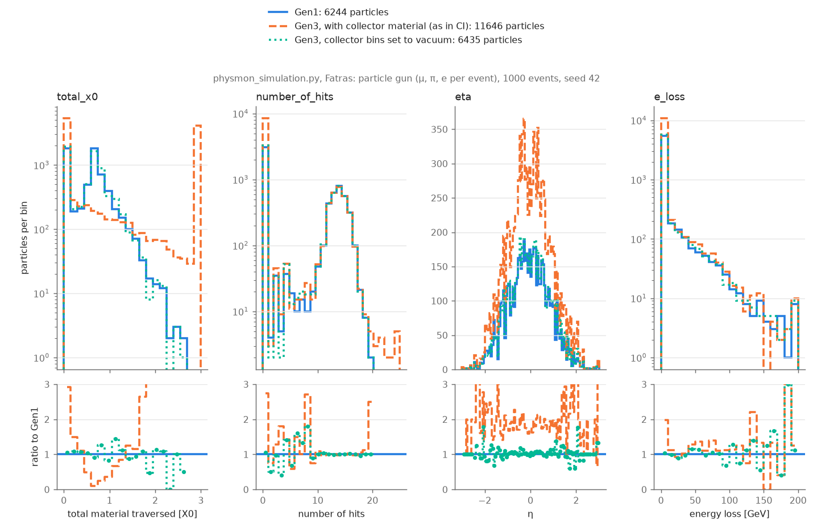

# Physmon checks: Gen3 vs. Gen1 ODD (ACTS PR #6273)

ACTS PR #6273 (`gen3-default`) makes the Gen3 (blueprint) OpenDataDetector
the default geometry, which changes the physmon output. This repository holds
the checks behind the answers to the physmon review: what changes, why, and
how to reproduce each result. All numbers come from local runs with the same
workflows, tools and settings as the physmon CI job, unless marked as CI
output.

## Results at a glance

| Topic | Result | Details |
|---|---|---|
| Fatras particles | the Gen3 map carries the calorimeter material on a collector surface outside the solenoid; with it set to vacuum, Gen3 is close to Gen1 (11 646 → 6 435 particles, Gen1 6 244) | [SIMULATION.md](SIMULATION.md) |
| Geant4 particles | only the larger kill volume (`highestTrackingVolume`, r 1245 instead of 1202 mm); with the Gen1 extent Gen3 is bit-identical to Gen1 | [SIMULATION.md](SIMULATION.md) |
| `nStates` cut-off | plotting artifact (profile axis ends at 29.5, already in Gen1); Gen3 has two material surfaces per endcap layer → ~8 more states forward; fit quality unchanged | [nstates/](nstates/README.md) |
| "Distributions go wider" | same cut-off: only a few forward tracks left in the profiles | [review_points/ §1](review_points/README.md#1-other-distributions-seem-to-go-wider-kf-gx2f-kf-refit) |
| GSF outliers | Gen1 navigation gap at the barrel ends (approach cylinders too short), fixed in Gen3 | [review_points/ §2](review_points/README.md#2-gsf-outliers-a-gen1-navigation-gap-at-the-barrel-ends) |
| ttbar track errors | +8–12 % with unchanged pulls: multiple scattering in the different Gen3 map | [review_points/ §3](review_points/README.md#3-ttbar-track-errors-change-pulls-do-not) |
| ttbar purity at \|η\| > 3 | ~55 tracks; matched tracks unchanged, Gen3 has more duplicates (~0.7 % lower purity); neither the collector nor the material on both disc faces is the cause | [review_points/ §4](review_points/README.md#4-ttbar-purity-at-the-acceptance-edge), [one-face test](review_points/followup_2026-11-25_oneface/README.md) |
| 1muon CKF, other failures | renumbered IDs, errors as in §3, strict ResidualCheck | [review_points/ §5](review_points/README.md#5-1muon-ckf-remaining-failures-not-raised-in-the-review) |
| CI at `00c67c41f` | remaining red checks with cause, fix and who can fix them (GSF FPEs, ColliderML, GNN, flaky fit test) | [review_points/ci_00c67c41f/](review_points/ci_00c67c41f/README.md) |



## Layout

| Path | Content |
|---|---|
| [`SIMULATION.md`](SIMULATION.md) | Fatras and Geant4 particles: findings, variants, reproduction |
| `0_gen1_local/` … `3_gen3_no_collector_material_gen1_kill_volume/` | the four simulation variants (ntuples, histograms, histcmp reports) |
| `reference/` | Gen1 CI reference histograms of the simulation |
| `inputs/` | patches of the simulation variants and `vacuum_collector.jq` |
| `plots/`, `scripts/` | overlay plots of the simulation variants and `overlay_simulation.py` |
| [`nstates/`](nstates/README.md) | number of track states in the track-fitting workflows |
| [`review_points/`](review_points/README.md) | review points 1–5 of PR #6273 |
| [`review_points/followup_2026-11-23/`](review_points/followup_2026-11-23/README.md) | follow-up of points 1, 3, 4, 5 (forward muons/electrons, 1muon track by track, material per region, residual binning) |
| [`review_points/followup_2026-11-25_oneface/`](review_points/followup_2026-11-25_oneface/README.md) | material on one endcap disc face only |
| [`review_points/ci_00c67c41f/`](review_points/ci_00c67c41f/README.md) | CI failures at `00c67c41f` |

## Common setup

- **ACTS:** standalone build with Python bindings and the DD4hep/Geant4
  plugins, environment via `source ~/setup_acts.sh` (Spack environment,
  `build/python/setup.sh`, Python venv). Commands that run workflows start from
  the ACTS source directory.
- **Base commits:** simulation, `nstates/` and `review_points/` were made at
  `gen3-default` @ `dd259a4dc`, the follow-ups on later states of the branch,
  the CI section at `00c67c41f`. Each README names its base.
- **Placeholders** in the commands: `<acts>` = ACTS source directory,
  `<this repo>` = this repository, `<w>` = any work directory,
  `<outdir>` = output directory of a workflow.
- **Python tools:** the analysis scripts need `uproot`, `numpy`, `awkward`,
  `matplotlib` (e.g. the acts-venv); they take file paths as arguments and
  explain their usage in the docstring.
- **Local changes as patches:** all code changes for a variant are stored as
  patches, made and applied like this:

  ```bash
  git diff -- CI/physmon > <this repo>/inputs/<name>.patch   # write the patch
  git apply --check <this repo>/inputs/<name>.patch           # later: test if it applies
  git apply <this repo>/inputs/<name>.patch                   # later: apply it
  ```

  `git diff` only records the changes relative to the current commit, so the
  base commit is noted next to each patch.
