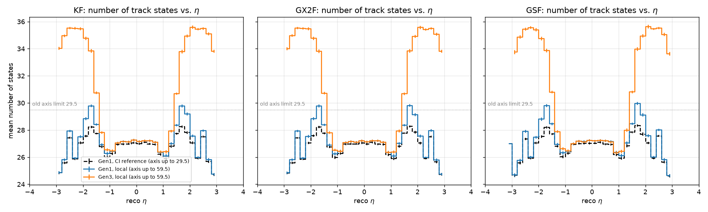

# Track fitting: number of track states (`nStates`)

[← overview](../README.md)

Question: why do the `nStates_vs_eta` profiles of the
track-fitting workflows (KF, GX2F, GSF, also refits and CKF) look cut off in
Gen3?



## Findings

- **The cut-off is a plotting artifact.** The profiles use the y-axis
  `BoostRegularAxis(30, -0.5, 29.5)`
  (`Examples/Framework/include/ActsExamples/Validation/TrackSummaryPlotTool.hpp`),
  and `ProfileHistogram` discards samples outside this range
  (`Core/include/Acts/Utilities/Histogram.hpp`, `sampleRange`). Tracks with
  30 or more states are therefore missing from the profile.
- **Gen1 was already affected.** The Gen1 CI reference of the KF contains only
  8 798 of 10 000 tracks; at 1.6 < |η| < 1.8 only 153 of 318 tracks are left
  (mean 28.3 instead of 29.8 with all tracks).
- **With the axis widened to 59.5, the cut-off disappears** (all 10 000 tracks
  in the profile, KF, GX2F and GSF alike). Gen3 then shows about 34–35.6 states
  for |η| > 1.6, compared to 25–30 in Gen1. In the barrel (|η| < 1), Gen1 and
  Gen3 are identical (27.16 vs. 27.16).
- **Origin of the extra states: two material surfaces per endcap layer.**
  Measurements, outliers and holes per track are identical in Gen1 and Gen3;
  the difference consists only of material-only states in the forward region
  (KF, 2.0 < |η| < 2.5: 14.8 → 23.2 material states per track). Gen1 has one
  material state per endcap layer at the layer centre (e.g. |z| = 1550 mm),
  Gen3 two at about ±10 mm (1540 and 1560 mm). The Gen3 ODD builder puts
  material on both disc faces of each endcap layer
  (`Plugins/DD4hep/src/OpenDataDetectorBuilder.cpp`, `customizeLayer`), but
  on only one cylinder face per barrel layer.
- **No effect on the fit quality.** The material is split between the two
  faces, not doubled. Pulls, resolution and χ²/ndf agree between Gen1 and
  Gen3 within statistics (KF, 1.5 < |η| < 3: pull q/p 0.939 vs. 0.949,
  χ²/ndf 0.784 vs. 0.786). The cost is about 8 more states per forward track.
- **Options:** (a) widen the `Num` axis (fixes a bias that already exists in
  Gen1, changes all references with this profile); (b) one material surface
  per endcap layer (Gen1-like state count, needs a new mapping).

## Contents of `nstates/`

| Path | Content |
|---|---|
| `nStates_vs_eta_axis59p5.png` | profiles KF/GX2F/GSF: Gen1 CI reference (axis up to 29.5), local Gen1 and Gen3 (axis up to 59.5) |
| `results/profiles_nStates_vs_eta.txt` | the same as a table, with the number of entries per bin |
| `results/state_types_kf_1000ev.txt` | state types per track by \|η\|, position of the material states along \|z\|, fit quality |
| `results/widths_gen3_vs_gen1.txt` | widths of residual and pull distributions, Gen3 vs. Gen1 |
| `data/axis59p5/{gen1,gen3}/trackfitting_{kf,gx2f,gsf}/` | `performance_trackfitting.root` of the physmon workflows, 10 000 events, axis up to 59.5 |
| `data/kf_1000ev/{gen1,gen3}/` | KF with track states written (`trackstates_kf.root`, `tracksummary_kf.root`), 1000 events, original axis |
| `reference/` | Gen1 CI references `trackfitting_{kf,gx2f,gsf}/performance_trackfitting.root` |
| `scripts/` | analysis scripts (`state_types.py`, `profiles.py`, `widths.py`) and `run_kf_with_states.py` |
| `inputs/axis_59p5.patch` | local change of the `Num` axis |

## How to reproduce

Same environment and base commit (`dd259a4dc`) as for the simulation ([SIMULATION.md](../SIMULATION.md)).

1. Axis: `git apply nstates/inputs/axis_59p5.patch`, then rebuild ACTS
   (`cmake --build build`).
2. Gen1 runs: apply `<this repo>/inputs/variant0_gen1.patch` and restore the Gen1 digi
   config, which `64a107fa3` regenerated for Gen3 volume IDs:
   ```bash
   git show 64a107fa3^:Examples/Configs/odd-digi-smearing-config.json > Examples/Configs/odd-digi-smearing-config.json
   ```
   Gen3 runs: unchanged code (provisional Gen3 map, release v1).
3. Run the workflows as in `CI/physmon/phys_perf_mon.sh`; the GSF fit needs the
   output of `simulation_gsf` next to it:
   ```bash
   source CI/physmon/setup.sh
   for slug in trackfitting_kf trackfitting_gx2f simulation_gsf trackfitting_gsf; do
     python3 CI/physmon/workflows/physmon_${slug}.py <outdir>/${slug}
   done
   ```
4. Track states (1000 events, without the axis patch):
   `DIGI=$PWD/Examples/Configs/odd-digi-smearing-config.json python3 <this repo>/nstates/scripts/run_kf_with_states.py <outdir>`
   after `source CI/physmon/setup.sh`, with the same Gen1/Gen3 setup as in
   step 2 (copies the output files to `<outdir>`).
5. Analysis (needs `uproot`, `numpy`, `awkward`, `matplotlib`), run from the root of this repository:
   ```bash
   python3 nstates/scripts/state_types.py > nstates/results/state_types_kf_1000ev.txt
   python3 nstates/scripts/profiles.py    > nstates/results/profiles_nStates_vs_eta.txt   # also writes the plot
   python3 nstates/scripts/widths.py      > nstates/results/widths_gen3_vs_gen1.txt
   ```
6. Restore the code: `git checkout Examples/` and rebuild.
