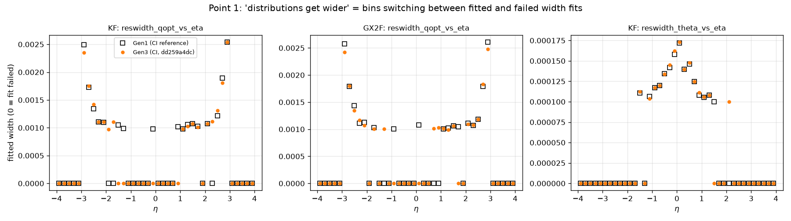
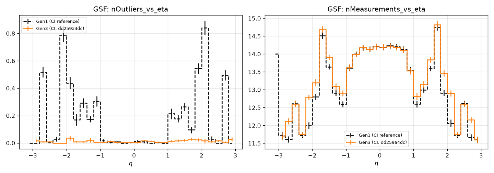
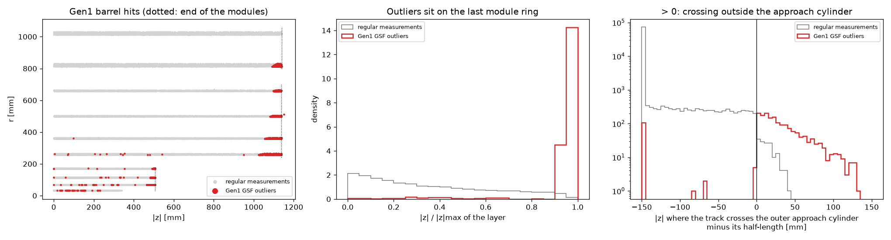
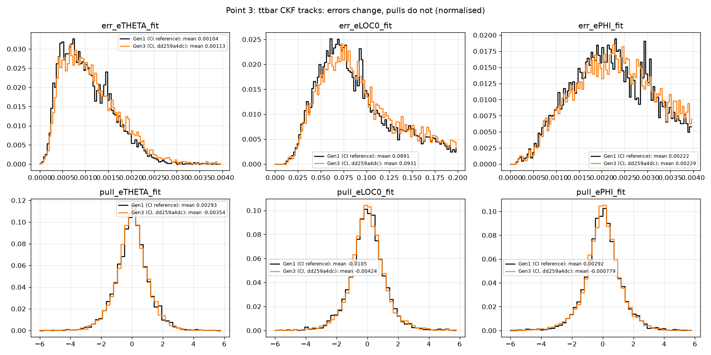
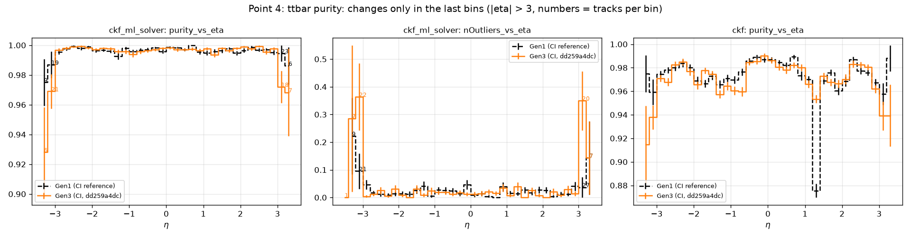

# Review points from the PR #6273 discussion

[← overview](../README.md)

Checks of the points raised in the review of
PR #6273 (physmon run of `gen3-default` @ `dd259a4dc`; reports:
`https://acts-herald.app.cern.ch/view/acts-project/acts/13004175552/html/`).
"CI Gen3" below means the physmon output of that run, compared to the Gen1
CI references.

| Review point | Explained by the nStates cut-off? | Cause |
|---|---|---|
| KF, GX2F, KF refit: nStates cut-off | yes | see [`nstates/`](../nstates/README.md) |
| KF, GX2F, KF refit: "distributions get wider" | yes | few tracks left in the nStates profiles (1) |
| GSF fit and refit: number of outliers | no | Gen1 navigation gap, fixed in Gen3 (2) |
| GSF, CKF (1muon, ttbar): nStates | yes | see [`nstates/`](../nstates/README.md) |
| ttbar: track errors change, pulls do not | no | multiple scattering with the Gen3 material map (3) |
| ttbar: purity reduced at the acceptance edge | no | ~55 tracks; duplicates, collector not involved (4) |
| 1muon CKF: remaining failures (not raised by Paul) | partly | IDs, errors as in (3), strict ResidualCheck (5) |

Points 1, 3, 4 and 5 were revisited on 2026-11-23; scripts, patches and
result tables of that follow-up are in `followup_2026-11-23/`
([its README](followup_2026-11-23/README.md)); the one-face test of point 4 is in
[`followup_2026-11-25_oneface/`](followup_2026-11-25_oneface/README.md).

## 1. "Other distributions seem to go wider" (KF, GX2F, KF refit)

Paul's remark follows directly on the nStates cut-off and refers to the
nStates profiles, e.g. ttbar ML solver `nStates_vs_eta`
(`trackfinding_ttbar_pu200/performance_finding_ckf_ml_solver.html#plot-24`;
per-bin table: `followup_2026-11-23/results/ttbar_ml_nStates_vs_eta.txt`).
Same cause as the cut-off: tracks with ≥ 30 states drop out of the profile,
and forward Gen3 tracks carry about 8 more material states. Forward, only
1–14 instead of about 220 Gen3 tracks per bin remain, so the error bars
(≈ σ/√N) become about 20 times larger and the points scatter. At
\|η\| ≈ 2.3–2.9 the Gen3 profile is empty (tracks have ~33 states). At the very
edge (\|η\| ≈ 3.1–3.3) tracks are short (7–9 measurements), stay just below 30
states in Gen3 (~28) and reappear above the Gen1 curve (~20). The single Gen3
bin at η ≈ −3.5 is one track. `nMeasurements_vs_eta` (`#plot-16`), which
counts no material states, agrees bin by bin; with the axis at 59.5 the
pattern disappears (`nstates/`).

Independently, `reswidth_*` / `resmean_*` comparisons also fail
(`results/ci_failed_comparisons.txt`): these hold a Gaussian fit per bin,
which fails (bin = 0) in many bins, and histcmp fails when a bin switches
between "fit succeeded" and "fit failed". Where both have a value, Gen1 and
Gen3 agree within 0.95–1.07. Paul did not refer to these.

## 2. GSF outliers: a Gen1 navigation gap at the barrel ends

- **What an outlier is here.** physmon's GSF has no χ²-based outlier finder.
  A measurement becomes an outlier only if the backward pass does not reach
  its surface (`Core/include/Acts/TrackFitting/GaussianSumFitter.hpp`, "Assign
  outliers to states whose surface the backward pass did not reach").
- **Numbers.** Gen1 0.181 outliers per track, all at \|η\| > 1; Gen3 0.012
  (CI and local runs agree exactly). In the same events
  (`results/gsf_same_events.txt`), 1 772 Gen1 outliers become 1 752 regular
  measurements in Gen3; measurements + outliers per track are identical in
  99.7 % of the tracks.
- **Where.** 93.7 % of the Gen1 outliers sit on the last module ring of a
  barrel layer (pixel barrel modules end at \|z\| = 507 mm, strip barrels at
  1139–1141 mm). For 78.5 % this is the last hit of the track in that barrel;
  the next hit further out is in an endcap (`results/gen1_gsf_outliers.txt`).
- **Why.** Gen1 finds a barrel layer via an inner and an outer approach
  cylinder, which end only 5–10 mm beyond the modules
  (`results/gen1_barrel_approach_geometry.txt`). In the forward pass, the
  track reaches the layer through the inner approach cylinder at smaller
  \|z\|. In the backward pass, the track comes back from the endcap and would
  have to cross the outer approach cylinder; being inclined, it crosses that
  radius at larger \|z\|, beyond the end of the cylinder. The navigator skips
  the layer, and the measurement becomes an outlier. This applies to 93.5 % of
  the Gen1 outliers but only 0.2 % of the regular measurements (right-hand
  plot above).
- **Gen3.** Each layer is a volume with portals on all sides, and the
  modules come from the surface array of the layer volume, without approach
  cylinders. The backward pass finds these modules, so the GSF now uses them.
  The other GSF changes (pull means, residuals) follow from the extra
  measurements; the pull widths stay comparable.

## 3. ttbar: track errors change, pulls do not

Plots `err_*` (`tracksummary_ckf.html#plot-8` to `#plot-12`) and `pull_*`
(`#plot-26` to `#plot-31`). The median errors on d0, z0, φ, θ grow by 8–12 %
(mean: θ +8 %, d0 +4.5 %), q/p is unchanged, pull widths agree within 1–2 %
(`results/ci_comparison.txt`, `followup_2026-11-23/results/ttbar_error_quantiles.txt`).
The whole distribution moves to larger errors: Gen3 lies below Gen1 at small
errors and above it at large ones, and more tracks fall into the overflow.
With ~10 000 tracks the means are known to ~0.5 %, so this is not a
fluctuation.

Checked with a local 1muon CKF run (`truth_smeared`, Gen1 and Gen3, same seed;
`followup_2026-11-23/results/1muon_local_tracks_gen1_vs_gen3.txt`):

- **Same tracks, same hits.** The muons are identical, and 95.7 % of the
  tracks have the same number of measurements on the same layers. For these
  tracks the errors still grow (median: d0 +1.7 %, z0 +3.6 %, φ +3.5 %,
  θ +5.0 %, q/p −0.3 %). The local run reproduces the CI numbers.
- **The growth scales with 1/pT**, as expected from multiple scattering:
  σ(θ) +7 % at pT 0.9–2 GeV, +3.7 % at 7–11 GeV; also larger forward
  (+2.7 % at \|η\| < 0.5, +7 % at \|η\| 2–3). The KF workflow (pT up to
  100 GeV, median 51 GeV) shows the same trend when split in pT (σ(θ) +8 % at
  1–4 GeV, +0.5 % at 30–100 GeV; `kf_errors_vs_pt.txt`), which is why its
  errors look unchanged overall.
- **The maps differ** (material validation with straight tracks through both
  geometries; `material_regions.txt`, `material_radial.txt`). Beam pipe and
  pixel layers are the same. In the barrel, Gen3 has ~12 % more material in
  the tracker, mostly on the long-strip layers (0.063 → 0.087 X0 at
  \|η\| < 0.5), and places it differently: at r = 204 mm (between pixels and
  strips) 0.0145 instead of 0.0072 X0, on the first short-strip layer 0.0099
  instead of 0.0172 X0. Forward, the total agrees within a few percent, but
  each disc carries material on both faces.

Fatras simulates with the same map, so the tracks really scatter more
(residuals in 1muon 3–6 % wider) and the pulls stay at 1. Which of the map
differences causes how much of the increase was not separated. Whether the
Gen3 map is closer to Geant4 than the Gen1 map is a question for the material
validation, not for physmon. ttbar itself could not be checked track by track
(no Pythia8 locally).

## 4. ttbar purity at the acceptance edge

Purity = fraction of the measurements on a track that belong to the matched
particle. Up to \|η\| = 3, Gen1 and Gen3 agree (0.996–0.999 with the ML
solver). Beyond, combining both sides:

| \|η\| > 3 | tracks Gen1 / Gen3 | outliers Gen1 / Gen3 | purity Gen1 / Gen3 |
|---|---|---|---|
| CKF + ML solver | 64 / 57 | 6 / 18 | 0.988 / 0.965 |
| CKF | 119 / 104 | 18 / 31 | 0.962 / 0.937 |

Gen3 has fewer tracks, more outliers and a lower purity at the edge on both
sides, but only in the outermost four bins with 6–23 tracks each
(`followup_2026-11-23/results/ttbar_ml_purity_vs_eta_edge.txt`), i.e. roughly
6 vs. 16–18 wrong hits (~2.5σ).

Two candidate causes were tested locally with the 1muon workflow restricted
to η 2.8–3.5 (CKF with truth seeds), for Gen1, Gen3, and Gen3 with the
collector material removed (`followup_2026-11-23/inputs/`):

- **Muons** (20 000; `forward_purity.txt`): purity is 1.0 everywhere (a single
  muon leaves no foreign hits to pick up), and the numbers of measurements,
  holes and outliers agree in all three variants. The navigation at the inner
  edge of the Gen3 endcaps works; the collector changes nothing for muons.
- **Electrons** (2000 events × 10 electrons, three seeds for Gen1 and Gen3;
  `forward_electrons_*.txt`):
  - The collector produces ~81 000 extra secondaries in Gen3 (the reason the
    Fatras particle list changes so much), but none of them leaves a hit in
    the tracker; only 40 move back towards the interaction point.
  - The matched tracks (one per particle) are the same in all variants
    (number and purity ≈ 0.997). Purity differences come only from duplicate
    tracks.
  - The duplicates are dominated by rare CKF combinatorial blow-ups in single
    events: one electron gives hundreds to thousands of tracks (largest
    cases: Gen1 56, 733, 926; Gen3 2032, 680, 368; Gen3 without collector 299).
    These occur in Gen1 and Gen3 and are random.
  - Without them (particles with more than 20 tracks removed), at η 3.2–3.5
    Gen3 has 30–40 % more duplicates than Gen1 in each seed
    (Gen1 1105 / 1000 / 1107, Gen3 1506 / 1423 / 1376) and a purity lower by
    ~0.7 % (Gen1 0.984 / 0.985 / 0.983, Gen3 0.976 / 0.977 / 0.978). Without
    the collector, Gen3 is the same as with it (0.974, 1510 duplicates).

Conclusion: the collector is not involved, the matched tracks are unchanged,
and at η > 3.2 Gen3 produces somewhat more duplicates (cause not identified).

Follow-up (2026-11-25, `followup_2026-11-25_oneface/`): material on only one
face of each endcap disc (Gen1 has one surface per layer), mapped from the same
recording as the provisional map (1M geantinos). The map with both faces made
this way is byte-identical to the provisional one. With one face, the forward
tracks have ~7 fewer states (η 2.8–3.2: 22 instead of 29; measurements
unchanged), but the duplicates stay at the Gen3 level (η 3.2–3.5 without
explosions: 1329 / 1474 / 1291 vs 1506 / 1423 / 1376 with both faces, Gen1
1105 / 1000 / 1107; purity 0.979 / 0.974 / 0.979 vs 0.976 / 0.977 / 0.978).
The material on both disc faces is therefore not the main cause of the extra
duplicates.
With only ~55 ttbar tracks in the affected bins, single bad tracks can shift
the ttbar numbers considerably; ttbar itself cannot be produced locally
(no Pythia8).

Side note: in the CKF without the ML solver, Gen1 has a purity dip at
\|η\| ≈ 1.3 (0.876, with 638 tracks instead of about 370 in the neighbouring
bins, i.e. many split tracks). It is gone in Gen3 (0.953, 457 tracks): the
barrel-endcap transition, the same region as in point 2.

## 5. 1muon CKF: remaining failures (not raised in the review)

`tracksummary_ckf` fails 18–20 of 55 comparisons per seeding, and
`performance_fitting_ckf` 33–45 of 234
(`followup_2026-11-23/results/1muon_herald_failed_plots.txt`). Statistics per
histogram: `1muon_{truth_smeared,seeded}_tracksummary_stats.txt`.

- `nStates`: the cut-off (9384 vs. 4925 tracks within the axis).
- `measurementLayer/Volume`, `outlierLayer/Volume`: renumbered geometry IDs.
  In addition, Gen3 volume IDs go up to 121 while the axis ends at 30, so
  only 39 730 of ~131 000 Gen3 measurements are inside the histogram
  (IntegralTest fails). `nMeasurements` is the same (13.71 vs. 13.71).
- Errors and residuals for d0, z0, φ, θ grow by 2–6 %, pulls stay at 1:
  same effect as point 3.
- The rest, e.g. `chi2Sum` (mean 22.57 vs. 22.60, RMS 7.58 vs. 7.60), fails
  only the ResidualCheck. In histcmp 0.12.0 this check fails when at least
  √(number of bins) bins have \|difference\|/error ≥ 1; for two statistically
  independent samples that happens in ~32 % of the bins. It passes only for
  event-by-event (near-)identical output, so any change of the material
  makes it fail even for unchanged distributions.
- The `performance_fitting_ckf` failures are the per-bin `pull*`/`res*`
  profiles and fits, which pick up the same small changes; not checked one
  by one.

## Contents of this folder

| Path | Content |
|---|---|
| `plots/` | the plots shown above |
| `results/ci_failed_comparisons.txt` | failed histcmp comparisons per CI report |
| `results/ci_comparison.txt` | tables behind points 1, 2a, 3, 4 |
| `results/gen1_gsf_outliers.txt`, `results/gsf_same_events.txt` | point 2 summary |
| `results/gen1_gsf_barrel_states.csv` | all measurement/outlier states on Gen1 barrel layers (GSF, local run) with the approach-cylinder crossing |
| `results/gen1_barrel_approach_geometry.txt` | Gen1 barrel layers: approach cylinders and module extent |
| `data/ci_gen3/`, `reference/` | CI Gen3 output and Gen1 CI references of the relevant workflows |
| `data/gsf_local/{gen1,gen3}/` | local GSF runs (same Geant4 events as physmon): track summaries and performance files |
| `scripts/` | `ci_failed.py` (needs internet), `compare_ci.py`, `run_gsf_with_states.py`, `gsf_outliers.py`, `gsf_plots.py`, `gen1_approach.py` (needs the ACTS Python environment) |

## How to reproduce

- `compare_ci.py`, `gsf_plots.py`: run from the root of this repository with
  `uproot`, `numpy`, `awkward`, `matplotlib`; they read only files in this folder.
- Local GSF runs: as for the track fitting in `nstates/` (Gen1: `<this repo>/inputs/variant0_gen1.patch`
  plus the Gen1 digi config), first `CI/physmon/workflows/physmon_simulation_gsf.py <dir>/simulation_gsf`,
  then `python3 <this repo>/review_points/scripts/run_gsf_with_states.py <dir>/gsf_full`
  (a copy of `physmon_trackfitting_gsf.py` that also keeps `trackstates_gsf.root` and
  `tracksummary_gsf.root`).
- `gsf_outliers.py <dir>/gsf_full/trackstates_gsf.root` (Gen1 run) writes the CSV;
  the track-states file (138 MB) is not stored here.
